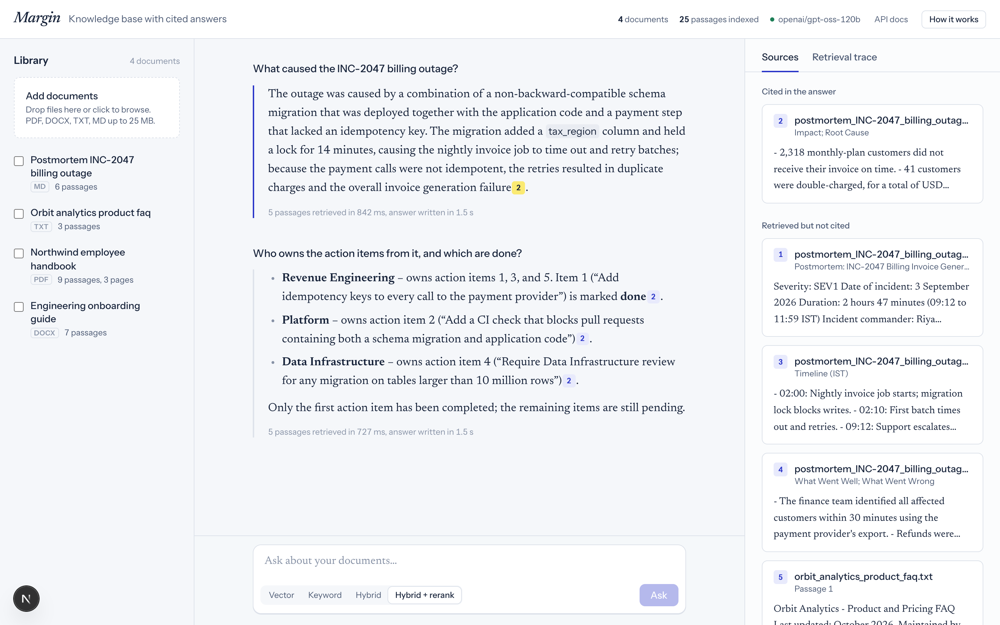
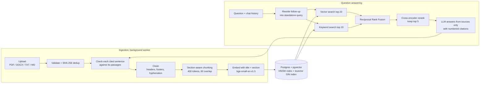
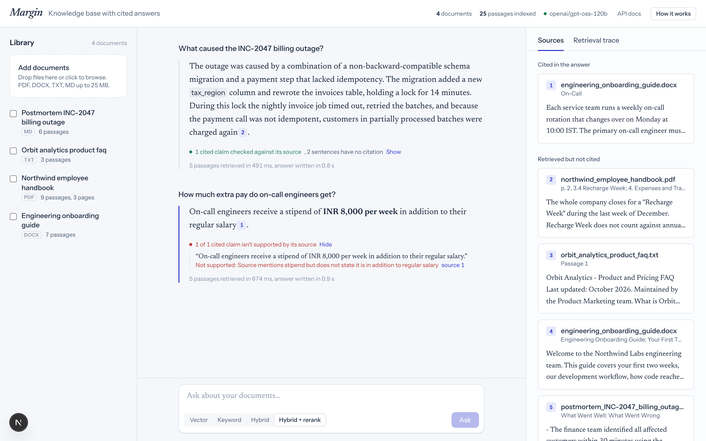

# Margin: AI knowledge base with cited answers

Upload PDFs, Word files or text notes, then ask questions in plain English. Every answer cites the file, page and section it came from, and a retrieval trace shows exactly how the supporting passages were found.

Built end to end with free, open-source parts: **FastAPI**, **PostgreSQL + pgvector**, local **ONNX** models via fastembed (about 350 MB RAM, no GPU), a free-tier LLM (**Groq**, or **Ollama** offline), and a **Next.js** frontend.



## Try it in one command

```bash
docker compose up --build
```

Open **http://localhost:3000**. Four demo documents (an employee handbook PDF, an engineering guide DOCX, an incident postmortem in Markdown and a product FAQ in plain text) are indexed automatically on first start, so you can click a suggested question straight away.

- **No API key needed to look around.** Without a key, Margin shows the most relevant passages and the full retrieval trace.
- **For written answers,** get a free key at [console.groq.com/keys](https://console.groq.com/keys), then run `cp backend/.env.example backend/.env`, set `LLM_API_KEY`, and run `docker compose up` again.
- API docs: http://localhost:8000/docs

## Results

### Public benchmark: BEIR SciFact

[BEIR SciFact](https://github.com/beir-cellar/beir) is a standard retrieval benchmark: 5,183 scientific abstracts and 300 test queries with expert relevance labels. It runs through the exact same ingestion and retrieval code as the app, on a laptop CPU ([`eval/beir.py`](backend/eval/beir.py), `make bench`).

| Retrieval mode | nDCG@10 | Recall@10 | p50 latency |
|---|---|---|---|
| Vector only (bge-small, pgvector HNSW) | 0.712 | 0.826 | 29 ms |
| Keyword, Postgres built-in `ts_rank` | 0.390 | 0.536 | 45 ms |
| Keyword, **BM25 implemented in SQL** | 0.696 | 0.818 | 97 ms |
| Hybrid (RRF) with `ts_rank` | 0.638 | 0.783 | 74 ms |
| **Hybrid (RRF) with BM25** | **0.724** | **0.853** | 136 ms |
| Hybrid with BM25 + MiniLM reranker | 0.714 | 0.848 | 1.2 s |

What this shows:
1. **The pipeline is correct.** Vector-only scores 0.712; the model's officially reported SciFact score is 0.713 ([model card](https://huggingface.co/BAAI/bge-small-en-v1.5)). Extraction, chunking, embedding and indexing lose nothing.
2. **Postgres' built-in ranking was the weak link.** `ts_rank` has no inverse document frequency, so a match on a common word counts as much as a match on a rare, informative one. It scored 0.39 and dragged hybrid search *below* vector-only. Implementing BM25 in SQL on the existing `tsvector` index raised keyword search to 0.70 and made hybrid the best mode (0.724), with no extra search engine ([bm25.py](backend/app/retrieval/bm25.py)).
3. **The reranker does not transfer to this domain.** `ms-marco-MiniLM-L-6-v2` was trained on web search queries. On scientific claims it slightly lowers accuracy and costs about 8× the latency, while on the company documents below it is the biggest single gain. Whether to rerank is a per-corpus decision, which is why the UI lets you switch retrieval modes and compare.

### Demo documents: 40 hand-labelled questions

The four demo documents come with 40 labelled questions ([`eval/dataset.jsonl`](backend/eval/dataset.jsonl)). Each is labelled with the evidence text that answers it rather than a chunk id, so labels stay valid when chunking changes.

| Retrieval mode | Hit@1 | Hit@5 | MRR@10 | p50 latency |
|---|---|---|---|---|
| Vector only | 0.62 | 1.00 | 0.79 | 23 ms |
| Keyword only (BM25) | 0.85 | 1.00 | 0.91 | 4 ms |
| Hybrid (RRF) | 0.82 | 1.00 | 0.90 | 22 ms |
| **Hybrid + cross-encoder rerank** | **0.95** | **1.00** | **0.97** | ~0.6 s |

| Hit@1 by question type | Exact identifiers (n=4) | Shared keywords (n=12) | Paraphrased (n=24) |
|---|---|---|---|
| Vector only | 0.50 | 0.83 | 0.54 |
| Keyword only (BM25) | 0.75 | 0.92 | 0.83 |
| Hybrid (RRF) | 0.75 | 0.92 | 0.79 |
| Hybrid + rerank | 0.75 | **1.00** | **0.96** |

On these short, policy-style documents the reranker is the biggest gain (0.82 → 0.95 Hit@1), almost all of it on paraphrased questions (0.79 → 0.96). Vector search alone struggles with exact identifiers such as `INC-2047` or `SEV2`. With only 25 passages this set is too small to rank the retrievers against each other reliably (BM25 alone edges out hybrid here, the opposite of SciFact), which is why the public benchmark is the primary result.

Answers were evaluated end to end with `openai/gpt-oss-120b` on Groq, graded by an LLM judge:

| Answer metric (40 answerable + 3 unanswerable questions) | Score |
|---|---|
| Correct (states the labelled fact) | 1.00 |
| Faithful (LLM judge: claims supported by the retrieved passages) | 1.00 |
| A cited passage contains the evidence | 1.00 |
| Refuses the unanswerable questions | 3 / 3 |
| Cited sentences confirmed by the sentence-level citation checker | 0.975 (39 / 40) |
| Answers containing a sentence with no citation | 5% |

The one sentence the checker rejected is the interesting result. Asked about on-call pay, the model wrote that the stipend is paid "in addition to their regular salary". The handbook never says that. The end-to-end judge passed the answer; the sentence-level check caught the embellishment.

Reproduce with `make eval` (retrieval) or `make eval-answers` (answers; about 130 LLM calls, paced for free-tier rate limits).

### Ablation study

[`eval/ablation.md`](backend/eval/ablation.md) switches off one design choice at a time on the demo set: contextual headers, the BGE query prefix, chunk overlap, 200- or 800-token chunks, and `ts_rank` instead of BM25. None moved hybrid + rerank by more than +0.02 Hit@1 (one question). Most telling is the last row: **BM25 versus `ts_rank` makes no measurable difference on the demo set, yet it is worth +0.31 nDCG@10 for keyword search on SciFact.** A small hand-written test set can hide large effects, which is the reason the public benchmark exists.

Engineering findings that did hold up:
- **Reranking the top 10 instead of 20 candidates gave identical accuracy at half the reranking cost**, which matters on small CPU hosts.
- **Ranking was initially non-deterministic.** Postgres returns rows with tied scores in physical storage order, so identical documents scored 0.78 Hit@1 for hybrid search in one database and 0.82 in another. A stable tie-breaker fixed it.
- **Batching hurt CPU inference.** Each batch is padded to its longest passage, so cross-encoder reranking in one batch of 20 was about 2.5× slower than scoring passages one at a time. Embedding now sorts texts by length before batching.

**CI quality gate:** every push runs the unit tests and [`eval/gate.py`](backend/eval/gate.py), which indexes the demo documents into a fresh Postgres and fails the build if hybrid + rerank drops below 0.90 Hit@1 or 0.93 MRR ([workflow](.github/workflows/ci.yml)).

## How it works



### Design decisions

**Extraction that keeps document structure.** PyMuPDF reads font sizes and weights to detect headings in PDFs; DOCX headings come from paragraph styles; tables are kept in document order. Running headers and footers are dropped when the same short text appears at the top or bottom edge of at least half the pages. ([extractors.py](backend/app/ingestion/extractors.py), [cleaner.py](backend/app/ingestion/cleaner.py))

**Chunking measured in the embedding model's own tokens.** Text is split into sentences, then packed into chunks of up to 400 tokens counted with the BGE tokenizer, so nothing is silently truncated at the model's 512-token limit. Chunks never cross a section boundary unless a section is tiny. Consecutive chunks overlap by whole sentences (about 60 tokens), so a fact on a boundary can be found from either side. ([chunker.py](backend/app/ingestion/chunker.py))

**Contextual embeddings.** Each chunk is embedded as `"{document title} > {section}\n\n{text}"`. A passage like "It must be returned within 7 days" is ambiguous on its own; the header supplies the missing context. Only the embedding sees the header; the stored text stays clean. Queries get BGE's retrieval instruction prefix, which the model was trained with.

**Hybrid search in a single database.** pgvector's HNSW index handles semantic search. A generated `tsvector` column with a GIN index handles keyword search, with no extra search engine. Postgres' `plainto_tsquery` requires every term to match, which almost never happens for natural-language questions, so the query is rewritten to OR the terms. Candidates are then scored with **Okapi BM25 computed in SQL**: term frequencies come from the position lists already stored in each `tsvector`, document frequencies from `ts_stat()` cached in a `term_stats` table that is refreshed after every ingestion, and document length from the chunk's token count. The two rankings are merged with Reciprocal Rank Fusion, which uses only rank positions and so needs no calibration between cosine similarities and BM25 scores. ([search.py](backend/app/retrieval/search.py), [bm25.py](backend/app/retrieval/bm25.py))

**Two-stage retrieval.** The fast retrievers collect 20 candidates; a cross-encoder (`ms-marco-MiniLM-L-6-v2`) then reads the question and each passage together and reorders them. On the demo documents it lifts Hit@1 from 0.82 to 0.95; on SciFact it does not help (see Results), so it is a configurable mode rather than a fixed stage.

**Grounded generation.**
- The prompt allows answers only from the numbered sources and requires a citation for each claim.
- It defines an exact reply for when the answer isn't present, and treats document text as data, not instructions (basic prompt-injection hygiene).
- Citation numbers the model invents are removed.
- Follow-up questions ("who owns those action items?") are rewritten into standalone queries using the chat history before retrieval. ([rag.py](backend/app/generation/rag.py), [prompts.py](backend/app/generation/prompts.py))

**Claim-level citation checking.** A citation marker only proves the model *pointed* at a passage, not that the passage says what the sentence claims. After generating, the answer is split into sentences with their `[n]` markers, and one extra LLM call checks every cited sentence against the exact passages it cites (paraphrase and simple arithmetic count as supported; added details do not). The UI reports "5 cited claims checked against their sources" or lists the sentences that failed, with the checker's reason. In a test with a tampered answer that changed the lock duration from 14 minutes to 2 hours, the checker flagged it with the reason "Source states lock was 14 minutes, not 2 hours." It adds about 0.7 s per answer. ([verify.py](backend/app/generation/verify.py))



**Provider-agnostic LLM.** Any OpenAI-compatible endpoint works. Groq's free tier is the default; switch to fully local Ollama by changing two environment variables.

**Operational basics.**
- Content-hash dedup and file validation by magic bytes.
- A per-document status lifecycle (`pending → processing → ready / failed`) with error messages and retry.
- Idempotent re-ingestion.
- Documents left mid-flight are re-queued when the server restarts.
- Timings are reported for every pipeline stage, and the UI displays them.

## Run locally without Docker

Requires Python 3.11+, Node 20+ and Docker (for Postgres).

```bash
make setup     # venv + pip install, npm install, copy .env
make db        # start Postgres + pgvector on port 5433
make api       # FastAPI on :8000 (indexes the demo docs on first start)
make web       # Next.js on :3000   (in a second terminal)
make test      # unit tests
make eval      # retrieval evaluation -> backend/eval/results.md
make ablation  # ablation study -> backend/eval/ablation.md
make gate      # CI quality gate (fails on retrieval regressions)
make bench     # BEIR SciFact benchmark -> backend/eval/beir_results.md
```

## Project layout

```
backend/
  app/
    ingestion/   extractors.py  cleaner.py  chunker.py  pipeline.py
    retrieval/   embedder.py  search.py  fusion.py
    generation/  llm.py  prompts.py  rag.py
    api/         documents.py  query.py
    models.py    schemas.py  config.py  main.py
  eval/          dataset.jsonl  run_eval.py  results.md
  tests/         unit tests (chunking, cleaning, fusion, citations)
frontend/        Next.js 16 app: library, conversation, sources + retrieval trace
sample_docs/     demo documents indexed on first start
scripts/         generates the demo PDF/DOCX from Markdown sources
```

## API

| Method | Path | Purpose |
|---|---|---|
| `POST` | `/documents` | Upload a file (multipart). Returns immediately; indexing runs in the background |
| `GET` | `/documents` | List documents with status, passage count, timings |
| `GET` | `/documents/{id}/chunks` | Inspect how a document was chunked |
| `POST` | `/documents/{id}/reprocess` | Re-index a document |
| `DELETE` | `/documents/{id}` | Delete a document and its passages |
| `POST` | `/search` | Retrieval only, with `mode` = `vector`, `keyword`, `hybrid` or `hybrid_rerank` |
| `POST` | `/ask` | Answer with citations, optional chat `history` and `document_ids` filter |
| `GET` | `/stats` | Counts and model configuration |

## Limitations and next steps

This is an MVP built to demonstrate retrieval and RAG engineering, not a production service.

- **Ingestion queue:** a single in-process worker thread. Production would use Celery, RQ or Arq with retries and horizontal scaling.
- **No authentication or multi-tenancy.** Next step: per-user collections with row-level security in Postgres.
- **No OCR** for scanned PDFs. Next step: Tesseract or a layout model such as Docling.
- **BM25 statistics are recomputed in full** after each ingestion (about 0.5 s for 6.6k chunks). At larger scale this would be an incremental update or a dedicated BM25 index such as ParadeDB `pg_search`.
- **Answers are not streamed.** Server-sent events would improve perceived latency.
- **Evaluation set is small and hand-written**, and it saturates (see the ablation note). Next step: a standard benchmark such as BEIR, plus tracking metrics in CI to catch regressions.
- **Possible retrieval upgrades:** a larger reranker (`bge-reranker-v2-m3`), late-interaction retrieval (ColBERT), parent-document retrieval for longer context.
